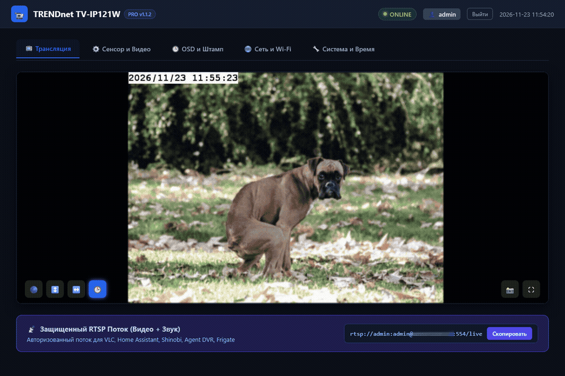
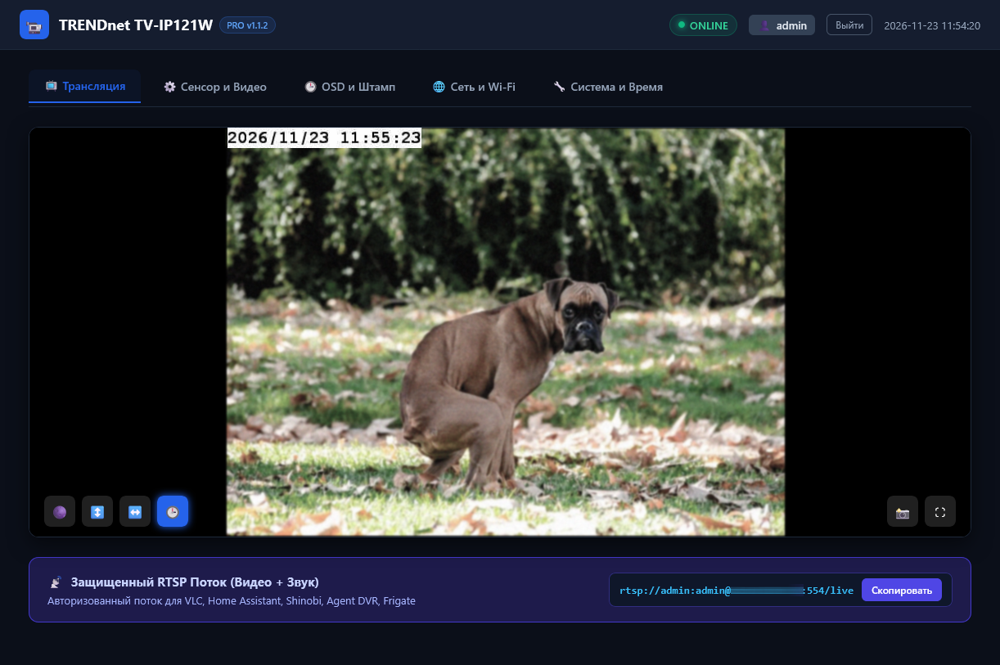
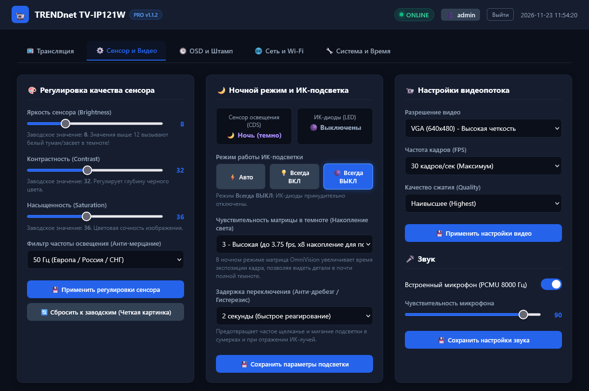
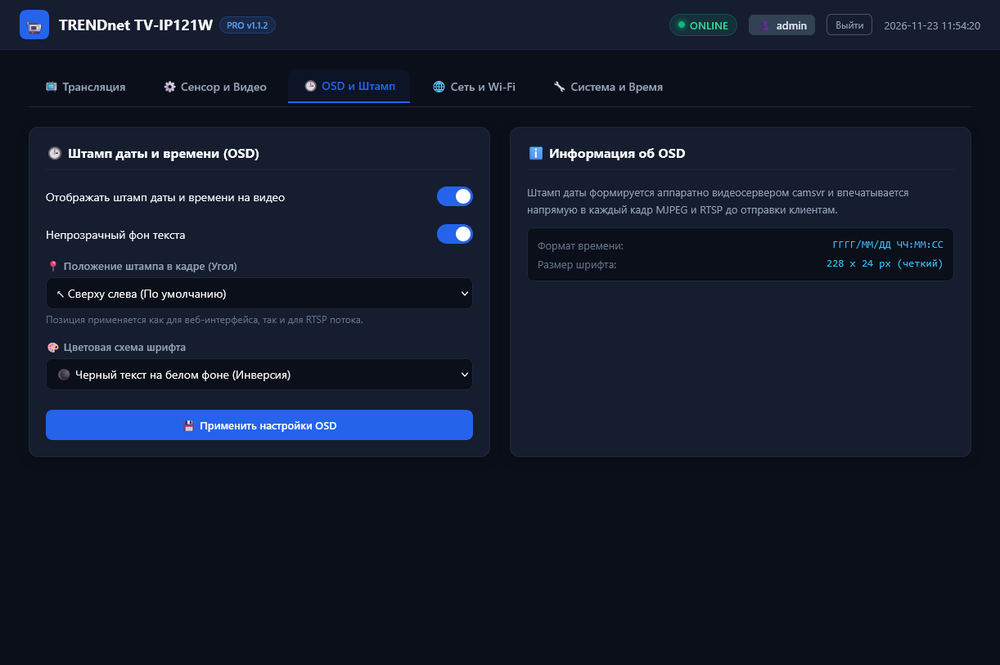
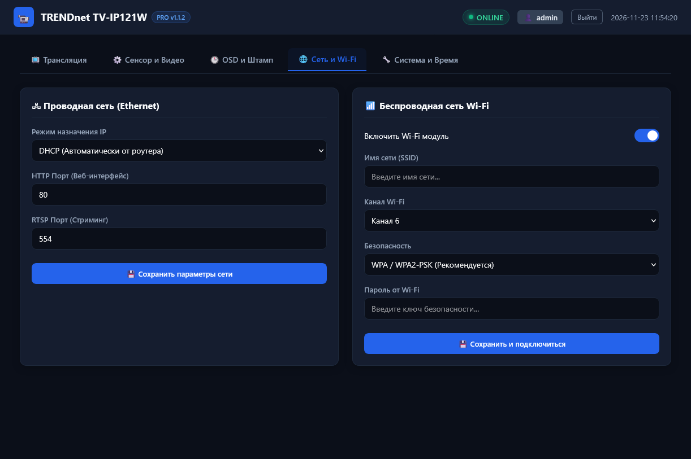
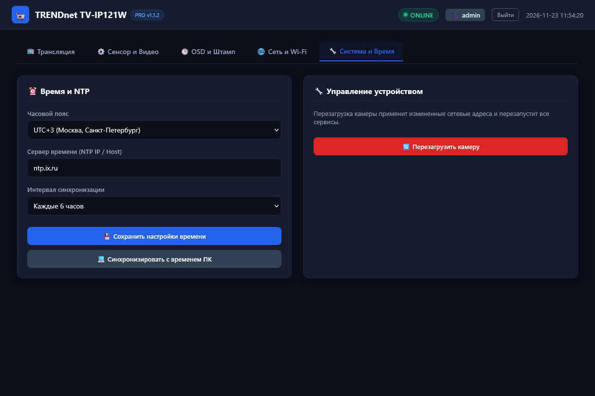

# TRENDnet TV-IP121W Custom Pro Firmware

[](https://github.com/internetson/trendnet-cleancam/actions/workflows/release.yml)
[](https://github.com/internetson/trendnet-cleancam/releases)
[](LICENSE)

Кастомная современная прошивка для сетевой IP-камеры **TRENDnet TV-IP121W (TV-IP121WN)** с нативным RTSP-сервером, передачей звука, откалиброванным динамическим диапазоном матрицы и современным адаптивным веб-интерфейсом.

---

## 📸 Скриншоты веб-интерфейса

<p align="center">
  
</p>

<details open>
  <summary><b>📺 Вкладка 1: Прямой эфир (Live Stream & RTSP)</b></summary>
  <p align="center">
    <a href="screenshots/1.png"></a>
  </p>
</details>

<details>
  <summary><b>⚙️ Вкладка 2: Настройки сенсора, видео и ИК-подсветки</b></summary>
  <p align="center">
    <a href="screenshots/2.png"></a>
  </p>
</details>

<details>
  <summary><b>🕒 Вкладка 3: Штамп даты и времени (OSD)</b></summary>
  <p align="center">
    <a href="screenshots/3.png"></a>
  </p>
</details>

<details>
  <summary><b>🌐 Вкладка 4: Проводная сеть и Wi-Fi</b></summary>
  <p align="center">
    <a href="screenshots/4.png"></a>
  </p>
</details>

<details>
  <summary><b>🔧 Вкладка 5: Системные настройки и время</b></summary>
  <p align="center">
    <a href="screenshots/5.png"></a>
  </p>
</details>

---

## 🌟 Основные возможности

* **RTSP сервер со звуком и аутентификацией:**
  * Видеопоток: `rtsp://admin:admin@<IP>:554/live` (MJPEG over RTP).
  * Аудиопоток: G.711 $\mu$-law (PCMU) 8000 Hz, 16-bit mono.
  * Полная защита потока: обязательная авторизация `admin:admin`.
* **Откалиброванное качество изображения (RFC 2435 In-Band DQT):**
  * Исправлена проблема выцветшего серого изображения и заниженного контраста на RTSP.
  * В заголовок RTP-пакетов внедряется аппаратная таблица квантования (DQT) сенсора камеры (`Q = 128`), восстанавливая полный динамический диапазон **0..255** и глубокий черный цвет.
* **Управление ИК-подсветкой и ночным режимом:**
  * Режимы: Авто (по датчику CDS с защитой от мерцания), Всегда ВКЛ, Всегда ВЫКЛ.
  * Аппаратное накопление экспозиции матрицы OmniVision (`psensor -night=0..3` от 30 fps до 3.75 fps для полной темноты).
  * Устранение аппаратного дребезга и ложных срабатываний от отражения ИК-лучей (микро-проба 80 мс с настраиваемой задержкой).
* **Современный Web-интерфейс (HTML5):**
  * Темная адаптивная тема для ПК и смартфонов.
  * Полноценная форма авторизации с сохранением сессии.
  * Интерактивное управление яркостью, контрастностью, ночным ИК-режимом (IR LED), частотой электросети (50/60 Гц).
  * Настройка расположения OSD (отметки времени) по 4 углам кадра (верхний левый, верхний правый, нижний левый, нижний правый) или полное отключение.
  * Быстрая синхронизация времени камеры с браузером в один клик.
* **REST API:**
  * Легкая интеграция в системы умного дома (Home Assistant, Node-RED, Frigate, Agent DVR).
* **Чистый код и безопасная сборка:**
  * Автономный C-демон `rtspd` под ядро Linux 2.4 (ARM GNU OABI, компиляция через Zig freestanding).
  * Чистая файловая система Minix v1 без сторонних зависимостей.

---

## 📺 Ссылки на потоки (Endpoints)

| Назначение | Протокол / URL | Описание |
| :--- | :--- | :--- |
| **RTSP Live Stream** | `rtsp://admin:admin@<IP>:554/live` | Основной RTSP поток (видео + звук) |
| **HTTP MJPEG Stream** | `http://<IP>/cgi/mjpg/mjpeg.cgi` | Потоковое MJPEG видео для браузера |
| **HTTP JPEG Snapshot**| `http://<IP>/cgi/jpg/image.cgi` | Снимок текущего кадра в полном разрешении |
| **HTTP Audio Stream** | `http://<IP>/cgi/audio/audio.cgi`| Прямой аудиопоток (G.711 $\mu$-law) |
| **REST API** | `http://<IP>/cgi-bin/custom_api.cgi`| JSON API управления настройками |
| **Web UI** | `http://<IP>/` | Панель управления камерой |

---

## 🏠 Интеграция в Home Assistant

Добавьте камеру в ваш `configuration.yaml`:

```yaml
camera:
  - platform: generic
    name: "TRENDnet Camera"
    stream_source: "rtsp://admin:admin@<IP КАМЕРЫ>:554/live"
    still_image_url: "http://admin:admin@<IP КАМЕРЫ>/cgi/jpg/image.cgi"
    authentication: basic
    verify_ssl: false
```

Либо добавьте камеру через стандартную интеграцию **Generic Camera** в интерфейсе Home Assistant:
* **Still Image URL:** `http://<IP КАМЕРЫ>/cgi/jpg/image.cgi`
* **Stream Source URL:** `rtsp://<IP КАМЕРЫ>:554/live`
* **Username:** `admin`
* **Password:** `admin`
* **RTSP transport:** `TCP`

---

## 🚀 Установка и прошивка

### Вариант 1. Через скрипт прошивки (Рекомендуется)
Склонируйте репозиторий и запустите скрипт:
```bash
python tools/flash_firmware.py <IP_КАМЕРЫ> FW_TV-IP121W_Custom_Pro_v1.1.2.pck
```
*Скрипт автоматически подключится к камере, загрузит прошивку и выведет статус записи в память Flash.*

### Вариант 2. Через оригинальный Web-интерфейс
1. Скачайте файл `FW_TV-IP121W_Custom_Pro_v1.1.2.pck` из раздела [Releases](https://github.com/internetson/trendnet-cleancam/releases).
2. Зайдите в веб-интерфейс камеры по ее IP-адресу (`admin` / `admin`).
3. Перейдите в **System** -> **Tools** -> **Firmware Upgrade**.
4. Выберите скачанный `.pck` файл и нажмите кнопку обновления.
5. Подождите около 40 секунд до перезагрузки устройства.

---

## 🛠️ Сборка из исходников

Для сборки прошивки требуется **Python 3.8+** и (опционально) компилятор **Zig** (версии 0.13.0+).

```bash
# Клонирование репозитория
git clone https://github.com/internetson/trendnet-cleancam.git
cd trendnet-cleancam

# Полная сборка (автоматически компилирует C-код и упаковывает Minix rootfs)
python build.py
```

Скрипт выполнит:
1. Кросс-компиляцию `src/rtspd.c` и `src/set_osd_corner.c` под целевую архитектуру ARM7/ARM9 (ARMv4 freestanding).
2. Патчинг заголовка ELF на `0x202` (GNU ARM OABI для ядра Linux 2.4.20) и замену инструкций `bx lr` на `mov pc, lr`.
3. Генерацию образа файловой системы Minix v1 с актуальными манифестами прав доступа.
4. Сборку и расчет контрольной суммы CRC32 и сигнатуры модели в готовый `.pck` пакет.

---

## 📁 Структура проекта

```text
├── .github/
│   └── workflows/
│       └── release.yml          # GitHub Actions: автоматическая сборка и публикация релиза
├── firmware/
│   ├── FW_TV-IP121W_1.1.1...pck # Базовая оригинальная прошивка
│   └── Firmware Upgrade...pdf   # Документация производителя
├── screenshots/             # Скриншоты и демонстрационная анимация веб-интерфейса
├── src/
│   ├── ir_ctrl.c                # Аппаратный контроллер ИК-подсветки и сенсора (PL1029 GPIO)
│   ├── rtspd.c                  # Исходный код RTSP-сервера (RFC 2435 + Audio + DQT)
│   └── set_osd_corner.c         # Утилита перемещения OSD через IPC Shared Memory
├── tools/
│   ├── flash_firmware.py        # Утилита прошивки камеры по сети
│   └── telnet_cmd.py            # Утилита удаленного выполнения команд через Telnet
├── extracted_rootfs/            # Дерево файлов корневой файловой системы
│   ├── sbin/
│   │   ├── ir_ctrl              # Скомпилированный контроллер ИК
│   │   ├── irled.sh             # Демон управления ИК с гистерезисом
│   │   ├── rtspd                # Скомпилированный RTSP-демон
│   │   └── set_osd_corner       # Утилита OSD
│   └── server/cgi-bin/
│       ├── custom_api.cgi       # REST API сервер
│       └── index.html           # Современный Web UI
├── rootfs_manifest.json         # Манифест прав, инодов и метаданных Minix FS
├── build.py                     # Главный скрипт сборки прошивки
├── .gitignore
├── LICENSE
└── README.md
```

---

## ⚙️ Архитектурные детали

* **Аппаратная платформа:** SoC Ralink/Winbond/Faraday ARM920T/ARM7.
* **Ядро:** Linux 2.4.20-uc0 (OABI, отсутствует поддержка EABI / Thumb bx lr).
* **Файловая система:** Minix v1 (размер блока 1024 байта, сжатие gzip).
* **Управление OSD:** Обращение к структуре в Shared Memory (`/dev/shm`), содержащей флаги наложения текста времени, даты и координат углов.

---

## 📄 Лицензия

Проект распространяется под лицензией **MIT**. Подробности в файле [LICENSE](LICENSE).
Оригинальные бинарные компоненты ядра принадлежат компании TRENDnet.